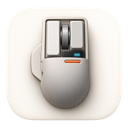

# Lofree Touch Bluetooth support for macOS

**Make the Lofree Touch's Bluetooth side buttons useful on a Mac.**

Lofree Bluetooth Mapper is a small menu-bar app that reads the mouse's side-button signals and turns them into navigation, keyboard shortcuts, or extra mouse-button events for Mac Mouse Fix. It does not install a driver or change your trackpad, pointer acceleration, or scrolling settings.

**Experimental · Apple Silicon · macOS Sequoia 15 or later · Bluetooth only**

[Download the app](https://github.com/newsman1/lofree-touch-macos/releases) · [Report an issue](https://github.com/newsman1/lofree-touch-macos/issues) · [Troubleshooting](docs/TROUBLESHOOTING.md)

## Why this exists

On the tested Lofree Touch, left/right/wheel clicks worked over Bluetooth, but the side buttons did not appear as standard macOS mouse-button events. The side signals were present in the device's raw Bluetooth HID reports.

This app reads those two signals directly. Its exact device profile avoids guessing about other mice, and input access is non-exclusive so normal mouse operation continues through macOS.

## Features

- Back/Forward defaults, with optional learning or swapping of the physical buttons.
- Saved click, double-click and hold assignments for each side button.
- Keyboard shortcut recording and built-in navigation/system actions.
- Automatic reconnection after sleep or Bluetooth disconnection.
- Launch at login, a compact menu-bar icon and no Dock icon.
- Optional Mac Mouse Fix bridge mode, emitting extra mouse buttons 4 and 5.

Actions include Back/Forward, previous/next tab, Copy/Paste, Undo/Redo, Mission Control, app windows, Spaces switching, Launchpad, Show Desktop, Spotlight, screenshot selection and custom keyboard shortcuts.

## Install

1. Download `LofreeBluetoothMapper-v0.4.2-arm64.zip` from [Releases](https://github.com/newsman1/lofree-touch-macos/releases).
2. Extract it and move **Lofree Bluetooth Mapper.app** to **Applications** before opening it.
3. This build is locally/ad-hoc signed, **not Developer ID signed or notarized**. macOS may block a downloaded copy. Review the source/build locally, or use the per-app **Open Anyway** option in Privacy & Security if you choose to trust it. Do not disable Gatekeeper or SIP.
4. Open the app and click **Grant permissions / retry**. Approve **Lofree Bluetooth Mapper** in Privacy & Security → **Input Monitoring** and **Accessibility**. Quit/reopen if requested.
5. Connect the Lofree over **Bluetooth**, with the USB receiver unplugged. Keep only one matching Lofree connected.
6. Choose **Built-in actions** and leave **Enable side buttons** on. Default clicks are Back and Forward. If their physical order is reversed, use **Swap** or **Learn Back / Learn Forward**; the choice is remembered.
7. Check **Launch at login** status if you want it to start after signing in. Registration is attempted automatically when first run from Applications, subject to macOS approval.

Close the Settings window to keep it running. Open Settings from the small mouse icon in the menu bar. **Pause** preserves assignments; **Quit** stops the app until you reopen it or the next login launches it.

## Button actions

Each logical side button has separate **Click**, **Double-click** and **Hold** assignments.

- Default clicks run on release without a double-click delay.
- Assigning a double-click action adds a 0.3-second wait to an isolated single click.
- A hold action runs once after 0.5 seconds and does not also click on release.
- Default double-click and hold assignments do nothing.

Back/Forward target Safari, Finder, Chrome, Edge, Brave and Firefox. Navigation/text presets use standard US keyboard keycodes; layouts, focus and app shortcut customization can affect them. The custom recorder stores the actual keycode and Command/Option/Control/Shift modifiers entered in this app's Settings window; it is not a global keyboard monitor.

### Spaces and other system actions

The **Previous Space / Next Space** presets currently send **Control–Left / Control–Right**. They work only if those match your enabled macOS Mission Control shortcuts. If your Mac uses different keys, the preset does not automatically discover them. Other system presets also assume the usual macOS shortcuts.

Custom shortcuts can be used when the desired combination uses the recorder's supported modifiers. The recorder in 0.4.2 does not preserve an Fn-only modifier. Automatic system-shortcut discovery and better Fn-key support are known limitations; see [troubleshooting](docs/TROUBLESHOOTING.md).

Spaces actions require more than one Space, and cannot move beyond the first/last Space in that direction.

## Mac Mouse Fix bridge

1. Run and enable [Mac Mouse Fix](https://macmousefix.com/).
2. In this app, select **Mac Mouse Fix bridge (experimental)**.
3. Try assigning the Lofree's side buttons in Mac Mouse Fix as buttons **4/5**.

Bridge mode disables this app's built-in actions, so one press does not run both mappings. Switching back retains the built-in assignments.

Button recognition was reported working with Mac Mouse Fix 3.1.0 on the test Mac. This is **not an official integration API**: the emitted events are synthetic, do not carry a genuine Lofree device identity, and may be ignored or grouped differently by other versions/settings. Full hold/drag gesture compatibility is not established. Bridge downs have a five-second release timeout to limit stuck buttons.

No Mac Mouse Fix source code is included in this project.

## Compatibility and limitations

The tested device identifies as **Touch@LOFREE**, vendor ID **9354**, product ID **33382**, transport **Bluetooth Low Energy**. The app additionally requires the exact 100-byte HID report descriptor in [SideDecoder.swift](Source/SideDecoder.swift). Different models, firmware, USB receiver/wired modes and multiple matching devices are not supported by this profile.

Basic navigation, click/double-click/hold actions, saved learning and Mac Mouse Fix bridge recognition were reported working on one user's Apple Silicon Mac running Sequoia 15.8.1. Wider hardware/OS compatibility and all login/wake combinations have not been systematically validated.

This version does **not** implement reverse scrolling, smooth scrolling, animated trackpad gesture synthesis, per-app profiles or hold-and-drag gestures. It does not automatically restart after a deliberate Quit or guarantee recovery after a crash.

## Permissions, updates and privacy

- **Input Monitoring** permits device input access. **Accessibility** permits the assigned synthetic keyboard/mouse output.
- Locally signed rebuilds can invalidate previous privacy approvals even when System Settings still shows an enabled entry. See the app-specific recovery steps in [Troubleshooting](docs/TROUBLESHOOTING.md).
- There is no driver, system extension, privileged helper, Bluetooth pairing change, network access, analytics or auto-updater.
- Settings are stored locally in UserDefaults under `local.lofree.bluetoothmapper`. No typing history or raw report history is saved.
- The bounded diagnostic log stays in memory. **Copy diagnostics** writes it to the clipboard only when requested; remove personal paths before posting it publicly.
- Original input is not suppressed. Do not configure two competing remappers to handle the same signals.

## Build and test

Requires Apple Command Line Tools (`xcrun swiftc`), macOS image tools and Python 3. No third-party packages are required.

```sh
sh build.sh
sh test.sh
```

The build targets `arm64-apple-macos15.0`, packages the included artwork, compiles against Apple frameworks, ad-hoc signs/verifies the app, and produces its ZIP in this folder. It does not install, launch, grant permissions or register a login item merely by building. Temporary build/test paths are printed and can be deleted afterward.

Tests cover report decoding, device-profile matching, saved calibration/settings, click/double-click/hold timing, cancellation and synthetic bridge event fields. Tests do not post input events. Optional capture replay expects the original development capture's five `08` and eight `10` gestures; the private capture itself is not included.

See [development notes](docs/DEVELOPMENT.md) for the report format, source layout and validation boundaries.

## Uninstall

1. Disable **Launch at login** in the app or remove it in System Settings → General → Login Items.
2. Quit the app.
3. Remove its Input Monitoring and Accessibility entries.
4. Delete the app.

Optional: after quitting, run `defaults delete local.lofree.bluetoothmapper` to remove saved assignments too. No pointer, trackpad or keyboard settings need restoration.

## License and acknowledgements

[MIT](LICENSE) · Copyright © 2026 newsman1.

Developed with assistance from OpenAI Codex. The app artwork was generated with an image-generation tool using a Lofree Touch product photo as visual reference; the reference photo is not distributed. The menu-bar outline is drawn natively. See [artwork notes](Assets/ARTWORK.md).

This is an independent community utility, not affiliated with or endorsed by Lofree or Mac Mouse Fix. Product names identify compatibility.
